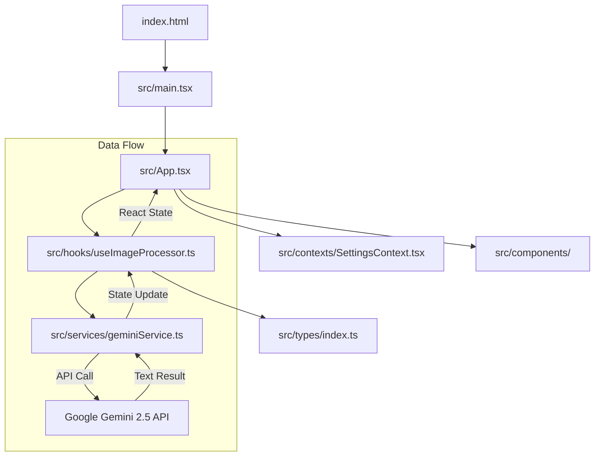

# TextExtractor AI 🚀

A premium, privacy-first web application designed to extract precise, editable text from images in seconds. Built with **React**, **Vite**, **TypeScript**, and **Tailwind CSS**, it integrates Google’s **Gemini 2.5 Flash** model via the official `@google/genai` SDK to deliver high-accuracy multi-language optical character recognition (OCR).

---

## 🏗️ System Architecture & Design Patterns

The codebase has been refactored under strict **Clean Architecture** and **Separation of Concerns (SoC)** guidelines. The layout is optimized to display software craftsmanship for senior engineering portfolios and academic evaluations.

### Architectural Blueprint



### Key Modules & Directories

- **`src/types/`**: Holds unified TypeScript interfaces (`ImageFile`, `ProcessStatus`) guaranteeing strict typings across the workspace.
- **`src/constants/`**: Consolidates application metadata, theme definitions, language settings, and dictionary configurations. Supports English, Arabic, and Russian.
- **`src/services/`**: Isolates third-party API communications. Uses the **Singleton Design Pattern** to instantiate and expose a single, thread-safe, lazy-initialized client connection to the Google GenAI library.
- **`src/hooks/`**: Abstracts complex workspace logics. Standard React states, paste handlers, drag-and-drop actions, download formatting, and asynchronous workflow sequences are isolated in the custom hook `useImageProcessor.ts`.
- **`src/contexts/`**: Provides global state providers for non-workspace configurations, such as language localization (i18n) and Tailwind-based Dark/Light theme class bindings.
- **`src/components/`**: Clean presentation components. Keeps layout markup (`App.tsx`) lightweight and focused solely on layout.

---

## 📂 Folder Directory Tree

```
textextractor-ai/
├── public/                     # Static assets (Favicons, assets)
│   └── favicon.svg             
├── src/                        # Source Directory
│   ├── components/             # Reusable UI components
│   │   ├── IconComponents.tsx  
│   │   ├── ImagePreviewModal.tsx
│   │   ├── ImageResultCard.tsx 
│   │   ├── ImageUploader.tsx   
│   │   └── ProgressBar.tsx     
│   ├── constants/              # App constants and translation resources
│   │   ├── i18n/               # Multi-language dictionary modules
│   │   │   ├── ar.ts           
│   │   │   ├── en.ts           
│   │   │   └── ru.ts           
│   │   └── languages.ts        
│   ├── contexts/               # React Settings Context & Translations
│   │   └── SettingsContext.tsx 
│   ├── hooks/                  # Custom State & Event hooks
│   │   └── useImageProcessor.ts
│   ├── services/               # API / Client Singleton Integrations
│   │   └── geminiService.ts    
│   ├── types/                  # Shared TypeScript interfaces
│   │   └── index.ts            
│   ├── App.tsx                 # Core Dashboard layout
│   └── main.tsx                # React mount entrypoint
├── .env.example                # Secret template configuration keys
├── .gitignore                  # Production exclusion directives
├── index.html                  # Main DOM index file
├── package.json                # Project dependencies and script declarations
├── tsconfig.json               # TypeScript compiler config
└── vite.config.ts              # Vite server configuration settings
```

---

## ⚡ Key Features

1. **Precision OCR**: Powered by Gemini 2.5 Flash, recognizing mixed languages (English, Arabic, Russian, etc.) including handwritten texts, emojis, and math equations.
2. **Batch Processing**: Upload, process, copy, and download multiple images simultaneously.
3. **Privacy First**: Images are handled completely on the client side, read into base64 generative parts, and transferred securely. No data is stored on servers.
4. **Theme Localization**: Adaptive HSL-based Tailwind theme supporting native light/dark toggle and localized text orientation (LTR for English/Russian, RTL for Arabic).

---

## 🛠️ Local Installation & Setup

Follow these steps to clone and run the application locally on your machine.

### Prerequisites

Ensure you have **Node.js** (v18 or higher) installed on your system.

### Steps

1. **Clone the Repository**:
   ```bash
   git clone https://github.com/Adel-dev-2001/textextractor-ai.git
   cd textextractor-ai
   ```

2. **Install Dependencies**:
   Navigate to the root directory and install node modules:
   ```bash
   npm install
   ```

3. **Configure Environment Variables**:
   - Duplicate the environment variable template:
     ```bash
     cp .env.example .env.local
     ```
   - Obtain a free Gemini API key from **[Google AI Studio](https://aistudio.google.com/)**.
   - Edit the newly created `.env.local` file and replace the placeholder value with your actual API key:
     ```env
     GEMINI_API_KEY=your_actual_api_key_here
     ```

4. **Launch Development Server**:
   Start the Vite local development instance:
   ```bash
   npm run dev
   ```
   Open `http://localhost:3000` in your web browser.

5. **Build for Production**:
   Compile assets and bundle for hosting:
   ```bash
   npm run build
   ```
   Deploy the generated `dist/` directory to static hosting services (Vercel, Netlify, Cloudflare Pages, etc.).

---

## 🎓 Academic Review & Scholarship Submission Notes

This project showcases:
- **Clean Code & Modern React Hooks Architecture**: Decoupling render instructions from state transitions.
- **Robust Exception Handling**: Custom async error mappings displayed visually on the frontend to improve UI reliability.
- **Lazy Service Initializers**: Managing memory efficiently.
- **Dynamic Localization (i18n)**: Programmatic direction changes and custom multi-lingual support without relying on bulky third-party libraries.
